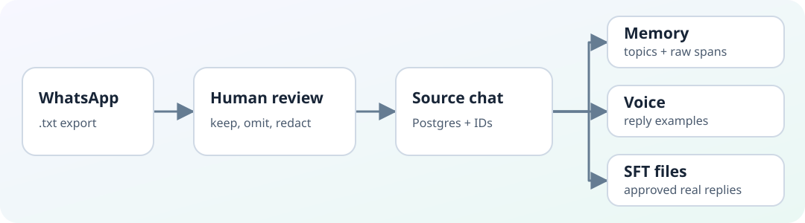
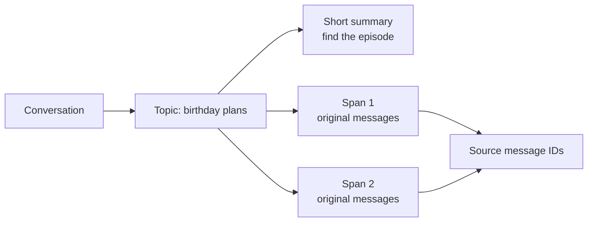

# Mirror 🪞

**Turn a WhatsApp export into searchable memories and examples of someone's voice.**

Mirror reads a `.txt` chat export, lets you review what may be used, and builds two searchable indexes: one for **what happened** in the conversation and one for **how a person replies**. It can also prepare examples for later fine-tuning. Today it is a data and retrieval toolkit, not a live WhatsApp bot or a trained twin.



## Run it

You need **Python 3.11+** and **Docker with Compose**. On Apple Silicon, topic detection runs locally. On other machines, [configure an OpenAI-compatible model endpoint](docs/whatsapp-onboarding.md#4-build-postgres-memory-and-both-vector-indexes).

The repository includes a **synthetic** WhatsApp-style export, so you can try the full flow without using a private chat:

```bash
scripts/setup-workspace.sh

scripts/onboard-chat.sh prepare data/export.txt \
  --target-author Rohan --owner-author Rohan \
  --persona-id hinglish-twin --user-id local-user \
  --contact-id aditi --chat-id hinglish-chat \
  --timezone Asia/Kolkata --all
```

Check `private-chats/hinglish-chat/review/part-*.txt`. To leave a message out or redact it, edit the matching `.jsonl` file. Then build the indexes and ask a question:

```bash
scripts/onboard-chat.sh index private-chats/hinglish-chat --approve

PYTHONPATH=src .venv/bin/python -m whatsapp.memory_cli \
  --user-id local-user --contact-id aditi --chat-id hinglish-chat \
  search 'Sea Breeze Terrace ka corkage charge kitna hai?'
```

For your own export, follow the [WhatsApp onboarding guide](docs/whatsapp-onboarding.md). It explains the default selection of the newest 30% of usable messages, private review files, and model setup. Real exports and review files stay in Git-ignored directories.

## The design, in plain English

### 1. Chunk by what you need to remember

**Memory follows topics.** A local model marks topic changes. Each topic gets a short summary for broad search, plus overlapping spans of up to **10 whole messages** (2 messages overlap) for exact details. A topic can return later in the chat; a long pause alone does not end it.



**Voice uses conversation windows.** Its chunks hold up to **5 whole messages**, overlap by 1, and split after a 120-minute gap. Each kept chunk contains a reply from the person being modelled, with the other speaker's messages still present for context. This gives retrieval an example of the reply *and* what prompted it. The window size is a measured choice, not a default — see [why 5](#why-the-voice-window-is-5-messages).

### 2. Keep memory and voice separate

A birthday fact may come from **either speaker**. A voice example must contain **the target person's reply**. Mirror therefore stores approved source messages in Postgres, topic summaries and raw-message spans in a Qdrant memory index, and target-author conversation chunks in a separate Qdrant voice index. Results keep source message IDs so you can trace an answer back to the chat.

### 3. Search with meaning and keywords

Both indexes combine dense vectors (meaning and paraphrases) with BM25 (names, unusual words, exact phrases). Memory search can find a topic summary or a raw span, expand a topic hit to its messages, and check Postgres for exact facts such as dates and IDs. A recent-message layer supports live replies; imported exports do not fill it. The voice index can optionally rerank its results.

This split is deliberate: summaries help find an episode, raw spans preserve the details, and original messages remain the evidence. Exact-fact extraction is cautious; on the synthetic Hinglish run it extracted **zero** structured facts, so those questions depended on message retrieval.

## The dataset and what we measured

We started with [`manishiitg/aditi-syn-v1`](https://huggingface.co/datasets/manishiitg/aditi-syn-v1), a synthetic Hindi/Hinglish question-answer dataset. We filtered to Roman-script text, removed repeated questions, and sampled **600 conversations / 1,200 messages** with a fixed seed. To make memory work harder, we added **34 written conversations / 601 messages** across eight scenarios: long topics, topic returns, self-disclosure, disagreement, changing plans, time gaps, emotional support, and edge cases. The combined export has **1,801 messages**. [REPORT.md](REPORT.md) records the filters, scenario counts, and build commands.

Each added conversation carried its own questions. Every answerable question included a quote, which the build matched to a unique source message ID. That gave us **188 answerable questions** across exact phrase, paraphrase, no-content-word-overlap semantic, temporal, attribution, multi-hop, situation, and style slices. We also wrote **3 unanswerable questions**.

### How we measure it

Three numbers, because any single one hides the trade-off:

| Metric | What it asks |
| --- | --- |
| **Answer found** (hit rate@5) | Is the correct message anywhere in the top 5 results? Its complement, the **miss rate**, is the unrecoverable failure: nothing in the returned evidence answers the question. |
| **Chars to answer** | Stack the results in rank order and count the characters you read before reaching the answering message. A median of 178 means roughly 2 messages of wading first. |
| **@N chars** | The share of questions whose answer arrives within N characters. Misses count as failures, so this is an end-to-end "solvable within a budget" rate. 500 characters is about 6 chat messages. |

We deliberately do **not** rank index designs by answer-found alone. A larger chunk holds more text, so "is the answer somewhere in it" gets easier as chunks grow — that measures the size of the net, not the quality of the search. *Chars to answer* is counted in characters, so different chunk sizes sit on the same scale.

### Why the voice window is 5 messages

Same 188 questions, same answer IDs, same retrieval mode. Only the window changed:

| Window | Chunks | Answer found | Median chars to answer | @500 chars |
| --- | ---: | ---: | ---: | ---: |
| 2 | 900 | 61.7% | **66** | **55.9%** |
| **5** | **758** | 65.4% | 178 | 50.5% |
| 10 | 679 | 69.1% | 354 | 42.0% |
| 20 | 638 | **75.5%** | 748 | 27.7% |

Wide windows find the answer most often but bury it deepest: at 20 messages you read about **11x further** before reaching it, and only **27.7%** of answers land in the first 500 characters. Narrow windows arrive fast but miss more often. **5 is the balance** — it keeps most of the reach while more than halving the reading distance.

The honest cost: narrower chunks also hurt the hardest slice. On the 34 questions with no shared content words, hybrid DBSF scored **44.1% at window 20 but 23.5% at window 5**. A single small chunk has to be ranked correctly on meaning alone, and the current dense model is English-focused. That gap is the main argument for replacing it.

Full sweep: `data/chunk-sweep.json`.

### Results

Scored against the voice index at top 5, with the answer allowed from **either speaker**:

| Voice retrieval mode | Answer found in top 5 | Median search time |
| --- | ---: | ---: |
| BM25 only | **66.5%** | 5.5 ms |
| Hybrid, score fusion (DBSF) | 65.4% | 10.1 ms |
| Hybrid, rank fusion (RRF) | 65.4% | 9.0 ms |
| Dense only | 48.9% | 8.7 ms |

To be clear about what this is and is not: it measures whether the right message came back, **not** whether the twin then answers correctly. Generation quality is not measured yet. **Style has only 3 questions**, so voice quality is not established either. And the **topic-memory index received manual spot checks, not this labelled benchmark** — every number here describes the voice index.

The full index build took **39 min 22 s** on the measured machine, almost all of it local topic-model inference. In a 128-document embedding benchmark, the voice model processed **59.1 docs/s** and the memory model **71.6 docs/s**. See the [full results and limitations](REPORT.md#5-results).

Re-run the labelled benchmark after indexing the bundled export:

```bash
PYTHONPATH=src .venv/bin/python -m whatsapp.eval_cli \
  --dataset data/evals.jsonl --k 5 \
  --evidence-scope any_author --format table

# chunk-size sweep, and the chars-to-answer breakdown
.venv/bin/python scripts/chunk-sweep.py --sizes 2 5 10 20
```

## Preparing SFT data

After review and indexing, Mirror pairs **real replies from the target author** with preceding chat context. It splits examples in time order into train, validation, and test (roughly 80/10/10). An optional model can draft new incoming questions for *training only*; the answer always stays the approved real reply. Unusable drafts fall back to the real prompt.

```bash
scripts/prepare-sft.sh private-chats/hinglish-chat --real-only
# Or try up to 20 generated training questions:
scripts/prepare-sft.sh private-chats/hinglish-chat --limit 20
```

Find the JSONL files, source IDs, and split report in `private-chats/hinglish-chat/sft/`. Review or remove examples before using them. This step **prepares data; it does not fine-tune a model**. See the [SFT guide](docs/sft-preparation.md) for the format and options.
